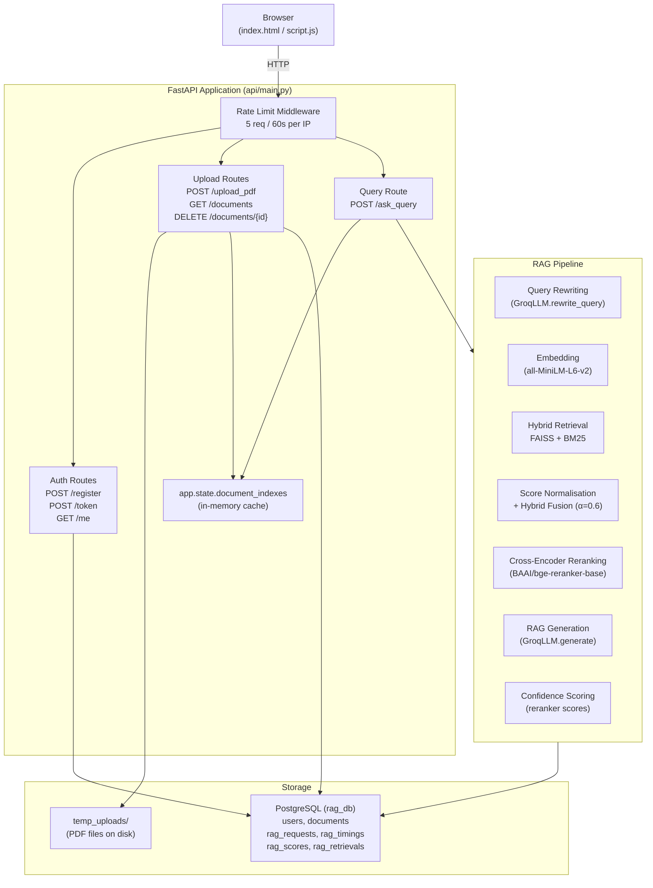

# RAG PDF Question Answering System

A multi-user, document-scoped question answering system built on a hybrid retrieval pipeline. Users upload PDF documents, which are indexed in memory per session. Questions are answered strictly from the uploaded document's content using a chain of query rewriting, hybrid retrieval, cross-encoder reranking, and LLM generation. Every request is fully traced in a PostgreSQL database.

---

## Overview

The system addresses the problem of answering factual questions from arbitrary PDF documents without relying on an LLM's parametric knowledge. It enforces strict context-only generation, meaning the LLM is explicitly instructed to refuse answers that cannot be grounded in the retrieved document chunks.

The pipeline combines dense semantic search (FAISS with `all-MiniLM-L6-v2` embeddings) and sparse lexical search (BM25) to handle both paraphrased queries and exact keyword lookups. A cross-encoder reranker (`BAAI/bge-reranker-base`) then reorders the hybrid results before generation. Confidence is computed from the reranker's output scores rather than from the LLM, making it independent of the model's self-reported certainty.

Authentication is handled with JWT tokens. Each document is owned by the user who uploaded it, and all query and document endpoints enforce ownership checks. A rate limiter (5 requests per 60-second rolling window per IP) is applied at the middleware layer.

---

## Key Features

- JWT-based user registration and login with Argon2 password hashing
- Per-user document ownership enforced on every endpoint
- PDF text extraction and cleaning via PyMuPDF
- Sentence-aware, token-counted chunking with configurable overlap (default: 250 tokens, 30-token overlap)
- Dense embeddings with `sentence-transformers/all-MiniLM-L6-v2`, L2-normalized, stored in a FAISS `IndexFlatIP`
- BM25 lexical index built with `rank-bm25` (whitespace tokenization, lowercased)
- Hybrid score fusion: `final_score = 0.6 * faiss_norm + 0.4 * bm25_norm`, top-8 candidates
- Cross-encoder reranking with `BAAI/bge-reranker-base`, sigmoid-normalized scores, top-5 selected
- LLM query rewriting via Groq API before retrieval
- Strict context-only RAG prompt; LLM returns "I don't know based on the provided context." when evidence is absent
- Retrieval-based confidence score derived from reranker output (not from the LLM)
- Per-stage latency instrumentation returned in every API response
- Full PostgreSQL observability: every request, its timings, chunk scores, and retrieved texts are persisted
- In-memory document index cache per server process with cold-start rebuild from stored PDF
- IP-based sliding window rate limiting (5 req/60s) with `Retry-After` headers
- Static HTML/JS/CSS frontend with login, document management sidebar, and per-response latency and confidence breakdowns

---

## Technology Stack

| Technology | Role |
|---|---|
| FastAPI | HTTP API framework, middleware, dependency injection |
| Uvicorn | ASGI server |
| PyMuPDF (`fitz`) | PDF text extraction |
| NLTK (`sent_tokenize`) | Sentence boundary detection for chunking |
| tiktoken | Token counting during chunking (gpt-4o encoding) |
| sentence-transformers | `all-MiniLM-L6-v2` bi-encoder for dense embeddings |
| FAISS (`faiss-cpu`) | `IndexFlatIP` vector index, inner product search on L2-normalized vectors |
| rank-bm25 | `BM25Okapi` sparse lexical index |
| pandas / numpy | Score normalization and hybrid fusion |
| sentence-transformers CrossEncoder | `BAAI/bge-reranker-base` cross-encoder reranker |
| Groq Python SDK | LLM API client for query rewriting and answer generation |
| PyJWT | JWT encoding and decoding |
| pwdlib (Argon2) | Password hashing and verification |
| psycopg2-binary | PostgreSQL driver for auth, document metadata, and observability logging |
| python-dotenv | Environment variable loading |
| HTML / CSS / JavaScript | Static frontend (no framework) |

---

## System Architecture



---

## Repository Structure

```
RAG PDF Chatbot/
│
├── api/
│   ├── main.py             # FastAPI app, CORS, rate limit middleware, router registration
│   ├── dependencies.py     # App state init (document_indexes, top_k, llm), get_current_user
│   ├── auth.py             # JWT creation/decoding, Argon2 password hash/verify
│   ├── models.py           # Pydantic schemas: RegisterRequest, LoginRequest,
│   │                       #   QuestionRequest, AskResponse, SourceModel,
│   │                       #   ConfidenceBreakdown, LatencyBreakdown
│   └── routes/
│       ├── auth_routes.py  # POST /register, POST /token, GET /me
│       ├── upload.py       # POST /upload_pdf, GET /documents, DELETE /documents/{id}
│       └── query.py        # POST /ask_query — full pipeline orchestration
│
├── loaders/
│   └── loader.py           # PyMuPDF extraction, hyphen/newline/whitespace cleaning
│
├── chunking/
│   └── chunker.py          # Sentence-aware chunking with tiktoken token counting
│
├── embeddings/
│   ├── embedder.py         # Singleton all-MiniLM-L6-v2, L2-normalized float32 vectors
│   └── re_ranker.py        # Singleton BAAI/bge-reranker-base, sigmoid normalization
│
├── vectorstore/
│   └── faiss_store.py      # IndexFlatIP build, save, load, search wrappers
│
├── retrieval/
│   ├── bm25_store.py       # BM25Okapi index build and search
│   └── hybrid_retriever.py # retrieve_hybrid, normalise_scores, calc_final_score
│
├── rag/
│   ├── pipeline.py         # run_rag_pipeline: context assembly, prompt, generation, sources
│   ├── prompt.py           # Strict context-only prompt template
│   ├── confidence.py       # compute_confidence: mean/agreement/dominance from rerank scores
│   └── latency.py          # timed_step: wraps any function call, returns (result, ms)
│
├── llm/
│   ├── groq_llm.py         # GroqLLM class: generate() and rewrite_query() via Groq API
│   └── dummy_llm.py        # DummyLLM stub for offline testing (no API key required)
│
├── logger/
│   └── logger.py           # PostgreSQL observability: init tables, log_query, log_timings,
│                           #   log_scores, log_retrievals
│
├── eval/
│   └── eval_loop.py        # Offline evaluation script: builds index, runs 20 queries across
│                           #   4 categories, computes Recall@k, Precision@k, MRR, Accuracy, P95
│
├── test_results/
│   ├── test_runner.py      # HTTP-based test runner against live API
│   ├── test_queries.py     # 14 test categories, 67 total queries, expected behaviors
│   ├── test_results_*.json # Raw JSON results from past runs
│   └── test_report_*.txt   # Human-readable reports from past runs
│
├── scripts/
│   └── build_index.py      # Standalone script: load PDF, build index, run single query
│
├── frontend/
│   ├── index.html          # Single-page app: auth, document sidebar, chat interface
│   ├── script.js           # All frontend logic: auth flow, upload, query, message rendering
│   └── styles.css          # UI styling
│
├── .env                    # Environment variables (not committed in production)
├── requirements.txt        # Python dependencies
└── testing_analysis.md     # Architectural ablation study results across 5 configurations
```

---

## Application Workflow

### PDF Upload

1. The authenticated user submits a PDF via `POST /upload_pdf`.
2. The file is saved to `temp_uploads/` with a UUID filename.
3. `load_pdf` (PyMuPDF) extracts text page by page, cleans hyphenated line breaks, collapses whitespace, and returns a single concatenated string plus page metadata.
4. `chunk_text` tokenizes the text into sentences (NLTK), accumulates sentences until the chunk reaches 250 tokens (tiktoken, gpt-4o encoding), then carries back up to 30 tokens of overlap sentences into the next chunk. Each chunk carries `document_id`, `chunk_id`, `chunk_index`, and `token_length` metadata.
5. `embed_chunks` encodes all chunk texts with `all-MiniLM-L6-v2` and returns L2-normalized float32 vectors.
6. `build_faiss_index` creates a `faiss.IndexFlatIP` and adds all vectors.
7. `build_bm25_index` lowercases and whitespace-tokenizes each chunk, then constructs a `BM25Okapi` index.
8. A document record is inserted into the `documents` table with `owner_user_id`, `original_filename`, `storage_path`, and `status = "ready"`.
9. The FAISS index, BM25 index, tokenized corpus, and chunks are stored in `app.state.document_indexes[document_id]` keyed by the document UUID.

### Query

1. The authenticated user submits `POST /ask_query` with `question` and `document_id`.
2. Ownership is verified against the `documents` table. If the document's indexes are not in the in-memory cache (e.g., after a server restart), they are rebuilt from the stored PDF on disk.
3. `GroqLLM.rewrite_query` sends the original question to the Groq API with a strict prompt instructing it to return only a concise, keyword-oriented rewritten query (max 50 tokens, temperature 0.0).
4. The rewritten query is embedded with `all-MiniLM-L6-v2`.
5. `retrieve_hybrid` runs FAISS inner-product search and BM25 scoring in parallel, then takes the union of their top-k result sets.
6. `normalise_scores` applies min-max normalization independently to FAISS and BM25 scores using pandas.
7. `calc_final_score` computes `final_score = 0.6 * faiss_norm + 0.4 * bm25_norm`, sorts descending, and returns the top-8 chunks.
8. `reranker` passes all (original question, chunk text) pairs to `BAAI/bge-reranker-base` in a single batch (batch_size=16), applies sigmoid normalization to the raw logits, attaches `rerank_score` to each chunk, and returns the top-5 by rerank score.
9. `run_rag_pipeline` assembles a numbered context string from the top-5 chunks, builds the strict RAG prompt, calls `GroqLLM.generate` (max 300 tokens, temperature 0.0), and computes the confidence score.
10. `compute_confidence` derives three components from the reranker scores: `mean_score` (average), `agreement` (1 / (1 + variance)), and `dominance` (top score minus second score). Final confidence = `0.5 * mean + 0.3 * agreement + 0.2 * dominance`, clipped to [0, 1].
11. Per-stage latency in milliseconds is collected by `timed_step` for all seven stages and returned in the response.
12. The request, timings, chunk scores (both hybrid and reranked stages), and chunk texts are written to four PostgreSQL tables.

---

## Technical Implementation

### Chunking

`chunk_text` in `chunking/chunker.py` uses NLTK sentence tokenization as the primary split boundary. It accumulates sentences into a buffer, counting tokens with tiktoken's gpt-4o encoding. When adding the next sentence would exceed 250 tokens, the current buffer is finalized as a chunk. Overlap is computed by walking backwards through the current buffer's sentences and collecting up to 30 tokens worth of sentences, which seed the next chunk. This preserves sentence integrity at chunk boundaries and avoids splitting mid-sentence.

### Hybrid Retrieval and Score Fusion

`retrieve_hybrid` in `retrieval/hybrid_retriever.py` queries both indexes independently and takes the set union of their result chunk indices. This means a chunk that appears in only one result set still participates in scoring, with a score of 0.0 for the absent index. After min-max normalization, the weighted sum `0.6 * faiss_norm + 0.4 * bm25_norm` is computed. The 0.6/0.4 split is hardcoded in `query.py`'s call to `calc_final_score`.

### Cross-Encoder Reranking

`reranker` in `embeddings/re_ranker.py` uses a singleton `CrossEncoder("BAAI/bge-reranker-base")`. It constructs (query, chunk_text) pairs from the original user question (not the rewritten query) and scores them in a single `model.predict` call. Raw logits are passed through sigmoid (`1 / (1 + exp(-score))`) to produce scores in (0, 1). The top-5 by this score are selected for generation.

### Confidence Scoring

`compute_confidence` in `rag/confidence.py` operates entirely on the list of reranker sigmoid scores. It computes:
- `mean_score`: arithmetic mean of all reranker scores
- `variance`: population variance of the scores
- `agreement`: `1 / (1 + variance)` — high when scores cluster tightly
- `dominance`: difference between the top and second scores — high when one chunk clearly leads

The weighted combination `0.5 * mean + 0.3 * agreement + 0.2 * dominance` is clipped to [0, 1] and rounded to 5 decimal places. All four components are returned in the `confidence_breakdown` field of the API response.

### RAG Prompt

`build_rag_prompt` in `rag/prompt.py` constructs a prompt that explicitly forbids the LLM from using outside knowledge. The context is formatted as numbered chunks ("Chunk 1:\n...\n\nChunk 2:\n..."). The instruction "If the answer cannot be found in the context, say: 'I don't know based on the provided context.'" is part of the system instruction.

### Authentication

`api/auth.py` uses `pwdlib` with the Argon2 backend for password hashing. JWTs are signed with HS256 using a secret from the environment. Tokens carry `sub` (user ID as string), `iat`, and `exp` claims. The `decode_access_token` function requires both `sub` and `exp` to be present. `get_current_user` in `dependencies.py` is a FastAPI dependency used by all protected endpoints.

### Document Ownership

Every document endpoint and the query endpoint calls `get_owned_document`, which queries the `documents` table with both `id` and `owner_user_id`. The query endpoint additionally checks the `owner_user_id` stored in the in-memory cache entry to prevent cross-user access even if a cache key were somehow shared.

### In-Memory Index Cache

`app.state.document_indexes` is a plain Python dict initialized in `initialize_app`. On upload, the indexes are stored immediately. On query, if the key is absent (server restart), `get_document_indexes` in `query.py` rebuilds the full pipeline from the stored PDF file. This means the system is functional after a restart without requiring a separate index persistence mechanism, at the cost of a cold-start rebuild latency.

### Rate Limiting

The middleware in `api/main.py` maintains a dict of per-IP `deque` objects storing request timestamps. On each request, timestamps older than 60 seconds are evicted. If the deque length reaches 5, a 429 response is returned with `Retry-After`, `X-RateLimit-Limit`, and `X-RateLimit-Remaining` headers. A periodic cleanup removes entries for IPs inactive for more than 1 hour. OPTIONS requests and the `/` and `/health` paths are exempt.

### PostgreSQL Observability

`logger/logger.py` creates four tables on import if they do not exist:

- `rag_requests`: one row per query — request UUID, user ID, original query, total latency, rewritten query, final answer
- `rag_timings`: one row per request — per-stage latency in milliseconds
- `rag_scores`: one row per chunk per stage — FAISS, BM25, hybrid, and rerank scores for both the initial top-8 and the reranked top-5
- `rag_retrievals`: one row per chunk per stage — the actual chunk text at each retrieval stage

All four logging functions catch exceptions silently to avoid failing the user-facing request if the database write fails.

---

## Installation and Setup

### Prerequisites

- Python 3.10 or later
- PostgreSQL 13 or later, running locally on port 5432
- A Groq API key

### Steps

1. Clone the repository and enter the project directory.

2. Create and activate a virtual environment:
   ```bash
   python -m venv venv
   venv\Scripts\activate      # Windows
   source venv/bin/activate   # macOS / Linux
   ```

3. Install dependencies:
   ```bash
   pip install -r requirements.txt
   ```

4. Create the PostgreSQL database and the two application-managed tables:
   ```sql
   CREATE DATABASE rag_db;

   \c rag_db

   CREATE TABLE users (
       id          BIGSERIAL PRIMARY KEY,
       email       TEXT UNIQUE NOT NULL,
       password_hash TEXT NOT NULL,
       created_at  TIMESTAMPTZ NOT NULL DEFAULT NOW()
   );

   CREATE TABLE documents (
       id               UUID PRIMARY KEY,
       owner_user_id    BIGINT NOT NULL REFERENCES users(id) ON DELETE CASCADE,
       original_filename TEXT NOT NULL,
       storage_path     TEXT NOT NULL,
       status           TEXT NOT NULL DEFAULT 'ready',
       created_at       TIMESTAMPTZ NOT NULL DEFAULT NOW()
   );
   ```
   The four observability tables (`rag_requests`, `rag_timings`, `rag_scores`, `rag_retrievals`) are created automatically by `logger/logger.py` on first import.

5. Create a `.env` file in the project root:
   ```
   GROQ_API_KEY=<your_groq_api_key>
   DB_PASSWORD=<your_postgres_password>
   JWT_SECRET_KEY=<a_long_random_secret>
   JWT_ALGORITHM=HS256
   ACCESS_TOKEN_EXPIRE_MINUTES=30
   ```

---

## Environment Configuration

| Variable | Purpose | Required |
|---|---|---|
| `GROQ_API_KEY` | Groq API key for LLM query rewriting and answer generation | Yes |
| `DB_PASSWORD` | Password for the local PostgreSQL `postgres` user | Yes |
| `DB_HOST` | PostgreSQL host (`db` in Docker Compose, `localhost` locally) | No |
| `DB_PORT` | PostgreSQL port | No |
| `DB_NAME` | PostgreSQL database name | No |
| `DB_USER` | PostgreSQL user | No |
| `JWT_SECRET_KEY` | Secret used to sign and verify JWT access tokens | Yes |
| `JWT_ALGORITHM` | JWT signing algorithm (default: `HS256`) | No |
| `ACCESS_TOKEN_EXPIRE_MINUTES` | JWT expiry in minutes (default: `30`) | No |

Database settings default to `host=localhost`, `port=5432`, `dbname=rag_db`, and
`user=postgres` when the corresponding variables are absent.

---

## Running the Application

### Docker Compose

1. Create `.env` from `.env.example` and replace every placeholder value.
2. Start the complete application:
   ```bash
   docker compose up --build
   ```

The frontend is available at `http://localhost:8080`, the API at
`http://localhost:8000`, and interactive API documentation at
`http://localhost:8000/docs`. PostgreSQL data, uploaded PDFs, and downloaded
model files are stored in named Docker volumes.

To stop the containers without deleting data, run:
```bash
docker compose down
```

To reset all Docker-managed application data, run:
```bash
docker compose down -v
```

### API Server

```bash
uvicorn api.main:app --reload
```

The server starts on `http://localhost:8000`.

### Frontend

Open `frontend/index.html` directly in a browser. The frontend connects to `http://localhost:8000`. No build step is required.

### Offline Evaluation Script

The evaluation script in `eval/eval_loop.py` requires a hardcoded PDF path to be updated before running:

```bash
python -m eval.eval_loop
```

This builds the index from the specified PDF and runs 20 queries across four categories (baseline, numerical, chunk_boundary, paraphrase), printing per-query metrics and a final summary.

### HTTP Test Runner

With the API server running and a document already uploaded:

```bash
python -m test_results.test_runner
```

Results are saved as timestamped JSON and text files.

---

## API Documentation

All endpoints except `GET /` and `GET /health` require a Bearer token in the `Authorization` header.

### Authentication

| Method | Endpoint | Purpose |
|---|---|---|
| POST | `/register` | Create a new user account |
| POST | `/token` | Log in and receive a JWT access token |
| GET | `/me` | Return the current authenticated user's ID |

**POST /register** — request body (JSON):
```json
{ "email": "user@example.com", "password": "minimum8chars" }
```
Returns 201 on success, 409 if the email is already registered.

**POST /token** — request body (`application/x-www-form-urlencoded`):
```
username=user@example.com&password=yourpassword
```
Returns `{ "access_token": "...", "token_type": "bearer" }`.

### Documents

| Method | Endpoint | Purpose |
|---|---|---|
| POST | `/upload_pdf` | Upload and index a PDF (multipart/form-data, field name: `file`) |
| GET | `/documents` | List all documents owned by the current user |
| DELETE | `/documents/{document_id}` | Delete a document, its database record, and its stored PDF |

**POST /upload_pdf** response (201):
```json
{ "message": "PDF Indexed Successfully", "document_id": "uuid", "total_chunks": 46 }
```

**GET /documents** response:
```json
{
  "documents": [
    { "document_id": "uuid", "filename": "report.pdf", "status": "ready", "created_at": "..." }
  ],
  "total": 1
}
```

### Query

| Method | Endpoint | Purpose |
|---|---|---|
| POST | `/ask_query` | Ask a question about an owned document |

**POST /ask_query** — request body (JSON):
```json
{ "question": "When was Kohli born?", "document_id": "uuid" }
```

**Response** (`AskResponse`):
```json
{
  "answer": "Virat Kohli was born on 5 November 1988.",
  "confidence": 0.71234,
  "sources": [
    { "chunk_id": "doc_uuid_0", "score": 0.923, "text": "..." }
  ],
  "confidence_breakdown": {
    "mean_score": 0.8821,
    "agreement": 0.7654,
    "dominance": 0.1203,
    "variance": 0.0043
  },
  "latency_breakdown": {
    "query_rewriting_ms": 412.3,
    "embedding_ms": 38.1,
    "hybrid_retrieval_ms": 5.2,
    "normalisation_ms": 1.1,
    "calculation_ms": 0.9,
    "reranking_ms": 4821.0,
    "generation_ms": 1203.4,
    "total_ms": 6482.0
  }
}
```

Returns 404 if the document does not exist or is not owned by the requesting user. Returns 409 if the document status is not `"ready"`. Returns 429 if the rate limit is exceeded.

---

## Database Schema

The application uses a PostgreSQL database named `rag_db` with six tables.

**users** — created manually during setup:
- `id BIGSERIAL PRIMARY KEY`
- `email TEXT UNIQUE NOT NULL`
- `password_hash TEXT NOT NULL`
- `created_at TIMESTAMPTZ DEFAULT NOW()`

**documents** — created manually during setup:
- `id UUID PRIMARY KEY`
- `owner_user_id BIGINT REFERENCES users(id) ON DELETE CASCADE`
- `original_filename TEXT`
- `storage_path TEXT` — path to the file in `temp_uploads/`
- `status TEXT` — always `"ready"` in the current implementation
- `created_at TIMESTAMPTZ DEFAULT NOW()`

**rag_requests** — created automatically by `logger.py`:
- `request_id UUID PRIMARY KEY`
- `user_id BIGINT REFERENCES users(id) ON DELETE CASCADE`
- `original_query TEXT`
- `latency_ms DOUBLE PRECISION`
- `rewritten_query TEXT`
- `final_response TEXT`
- `created_at TIMESTAMPTZ DEFAULT NOW()`

**rag_timings** — one row per request, foreign key to `rag_requests`:
- Per-stage latency columns: `query_rewriting_ms`, `embedding_ms`, `hybrid_retrieval_ms`, `normalisation_ms`, `calculation_ms`, `reranking_ms`, `generation_ms`, `total_ms`

**rag_scores** — one row per chunk per retrieval stage:
- `retrieval_stage VARCHAR(30)` — either `"initial"` (hybrid top-8) or `"reranked"` (top-5)
- `chunk_rank INTEGER`
- `faiss_score`, `bm25_score`, `hybrid_score`, `rerank_score DOUBLE PRECISION`

**rag_retrievals** — one row per chunk per retrieval stage:
- `retrieval_stage VARCHAR(30)` — either `"hybrid_retrieval"` or `"reranked"`
- `chunk_rank INTEGER`
- `chunk_text TEXT`

---

## Testing and Evaluation

### Offline Evaluation (`eval/eval_loop.py`)

Runs the full pipeline directly (no HTTP) against a local PDF. Computes four metrics per query using substring matching against expected answers:

- **Recall@k**: 1 if any of the top-k reranked chunks contains the expected answer substring
- **Precision@k**: fraction of top-k chunks containing the expected answer substring
- **MRR**: reciprocal rank of the first chunk containing the expected answer
- **Accuracy**: 1 if the generated answer contains the expected answer substring
- **P95 Latency**: 95th percentile of per-query wall-clock time

### HTTP Test Runner (`test_results/test_runner.py`)

Sends requests to the live API across 14 query categories defined in `test_results/test_queries.py`. Categories include baseline factual, numerical, semantic, ambiguous, multi-hop, negation, temporal, out-of-scope, adversarial, edge cases, confidence testing, chunk boundary, paraphrase, and retrieval stress. Results are saved as timestamped JSON and text files.

### Ablation Study Results

Five architectural configurations were evaluated on 20 queries across four categories. Results are documented in `testing_analysis.md` and `testing_results_metrics.md`.

| Configuration | Recall@k | Precision@k | MRR | Accuracy | P95 Latency |
|---|---|---|---|---|---|
| Old chunker + old loader | 0.85 | 0.57 | 0.74 | 0.55 | 16.9s |
| New chunker + old loader | 0.90 | 0.51 | 0.71 | 0.50 | 9.3s |
| New chunker + old loader + improved rewrite prompt | 0.90 | 0.54 | 0.76 | 0.65 | 8.7s |
| New chunker + new loader + improved rewrite prompt | 0.90 | 0.53 | 0.78 | 0.60 | 11.0s |
| + BGE cross-encoder reranker (current) | 0.90 | 0.55 | 0.825 | 0.55 | 9.3s |

Accuracy is measured by exact substring matching, which underestimates true correctness for answers that are semantically correct but worded differently. The evaluation dataset is a single Virat Kohli Wikipedia article PDF; these numbers do not generalize to other documents.

---

## Limitations

- The database connection parameters (`host`, `port`, `dbname`, `user`) are hardcoded to `localhost:5432/rag_db/postgres` across `auth_routes.py`, `upload.py`, `query.py`, and `logger.py`. There is no connection pooling; a new connection is opened and closed for every database operation.
- Document indexes are stored only in the server process's memory. A server restart requires a cold-start rebuild from disk on the next query for each document.
- The `scripts/build_index.py` script contains a hardcoded absolute Windows path and has most of its query logic commented out. It is not runnable without modification.
- The `eval/eval_loop.py` script also contains a hardcoded absolute Windows path and must be edited before use.
- The `test_results/test_runner.py` sends requests without a `document_id` field, which does not match the current `QuestionRequest` schema. It would need to be updated to work with the authenticated, document-scoped API.
- The LLM model name in `llm/groq_llm.py` is set to `"openai/gpt-oss-120b"`. The original README referenced `llama-3.3-70b`; the actual model used depends on what Groq serves under that identifier.
- BM25 tokenization uses simple whitespace splitting without stopword removal or stemming, which limits lexical matching quality for morphologically varied queries.
- Accuracy evaluation uses substring matching, which both over-counts (partial matches) and under-counts (correct but differently worded answers). No semantic evaluation metric is implemented.
- There is no document re-indexing endpoint. If a document's index is evicted from memory and the PDF file is deleted, the document becomes unqueryable.
- The `.env` file in the repository contains credentials and should be rotated and excluded from version control.
